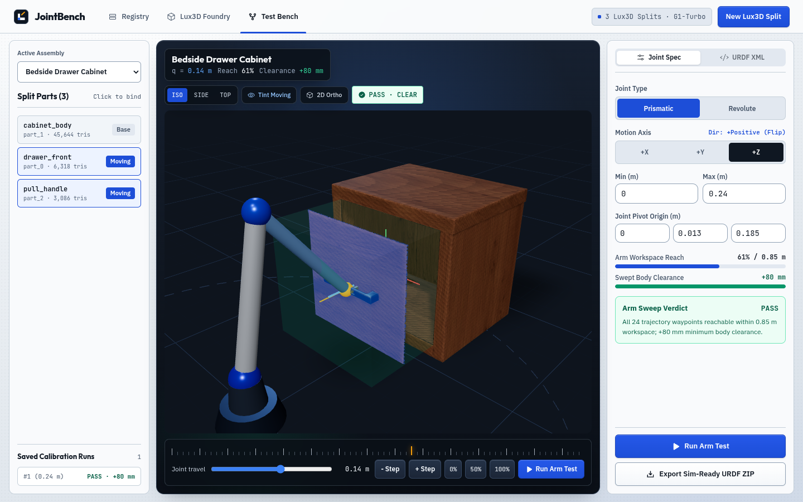
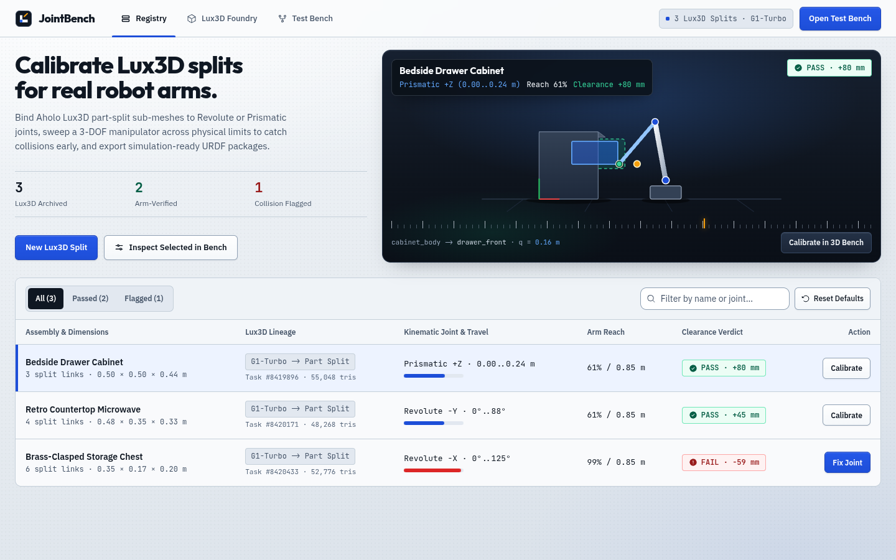
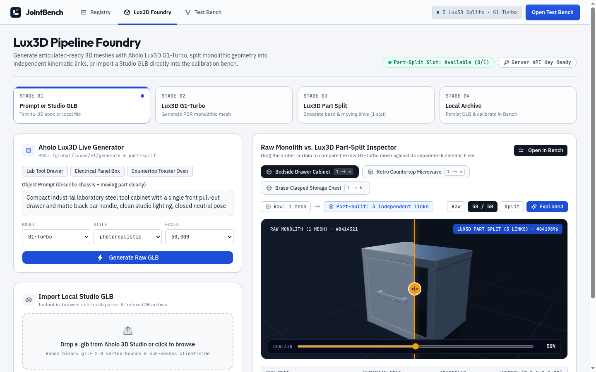
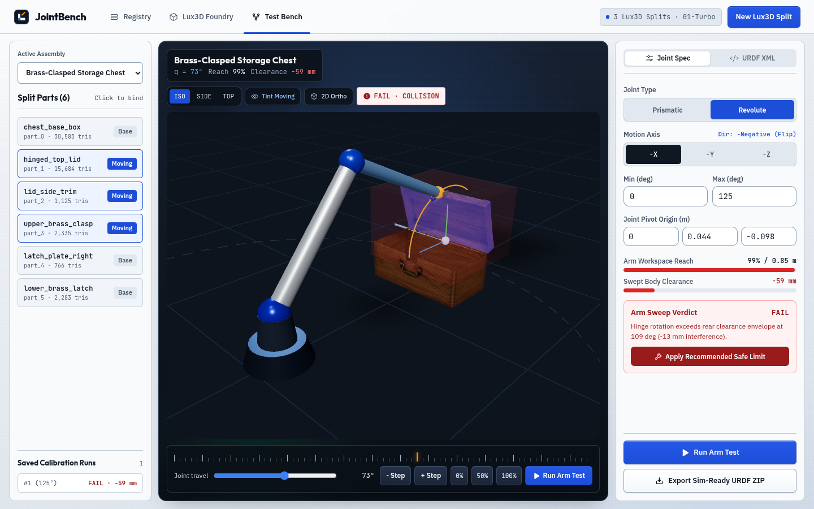
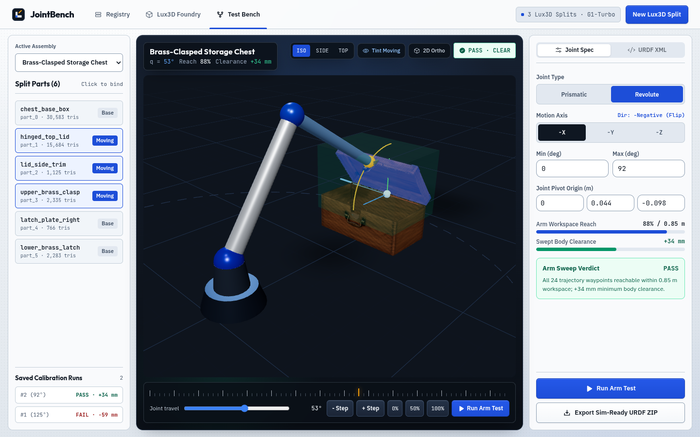
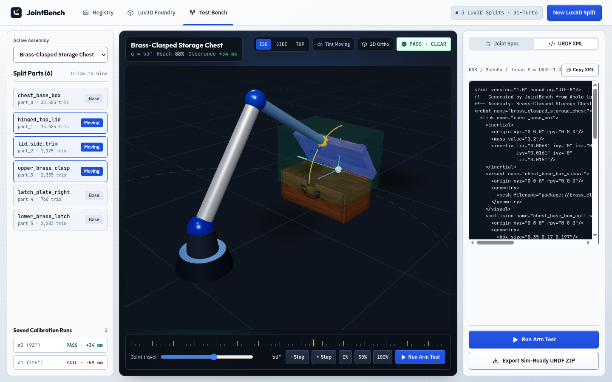
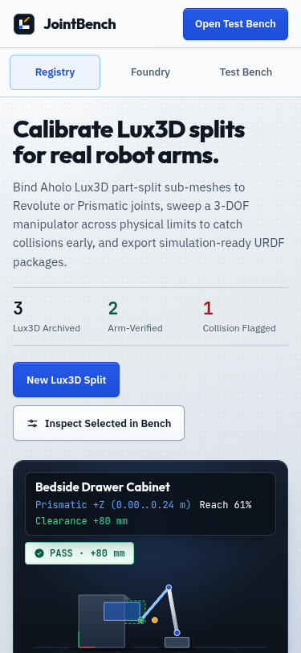
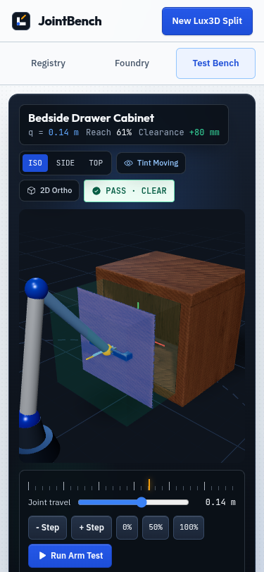
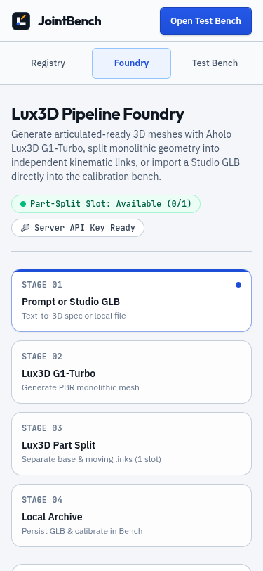
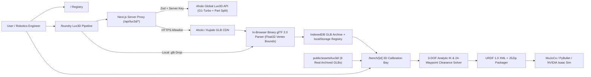

<div align="center">

# JointBench

**Kinematic Calibration, 3-DOF Robot Arm Verification, and URDF 1.0 Packaging Workbench for Aholo Lux3D Part-Split Assets**

Built for the **Manycore Aholo Global 3D AI Hackathon** (Embodied AI & Robotics Track)


</div>

---



*Bedside Drawer Cabinet generated via Aholo Lux3D `G1-Turbo` (`#8414321`) and separated via Lux3D Part Split (`#8419896`, 3 independent links). The drawer front and brushed handle physically slide `+0.14 m` along `+Z` inside the 3-DOF robotic arm gripper with `+80 mm` verified body clearance.*

---

## Table of Contents

- [Why JointBench Exists](#why-jointbench-exists)
- [Visual Product Tour](#visual-product-tour)
- [System Architecture](#system-architecture)
- [Verified Aholo Lux3D API Integration](#verified-aholo-lux3d-api-integration)
- [Archived Real Lux3D Benchmarks](#archived-real-lux3d-benchmarks)
- [3-DOF Robotic Arm IK & Clearance Solver](#3-dof-robotic-arm-ik--clearance-solver)
- [Sim-Ready URDF 1.0 ZIP Specification & Simulator Recipes](#sim-ready-urdf-10-zip-specification--simulator-recipes)
- [Project Structure](#project-structure)
- [Local Development](#local-development)
- [Deploying to Vercel](#deploying-to-vercel)
- [Verification & Security Audit](#verification--security-audit)

---

## Why JointBench Exists

Generative 3D platforms such as **Aholo Lux3D** produce detailed PBR meshes in under a minute, yet raw generated objects fail immediately when loaded into robotics simulators (**MuJoCo**, **PyBullet**, **NVIDIA Isaac Sim**):

1. **Monolithic geometry cannot articulate.** A cabinet drawer fused into its carcass cannot slide open during a manipulation rollout.
2. **Even split sub-meshes carry zero kinematic semantics.** A part-split `.glb` still lacks parent/child link roles, joint type (`prismatic` vs. `revolute`), signed motion axes, pivot origins, travel limits, and a grasp handle frame.
3. **Unchecked travel limits break real robot policies.** An over-extended hinge stop (for example, opening a storage chest lid to `125 deg`) causes rear-body collision (`-59 mm`) or saturates a tabletop manipulator's radial reach (`99%`).

**JointBench** turns raw Aholo Lux3D meshes into verified, simulation-ready robotic assets in a single browser-based engineering loop:

- **Generate & Split:** Queue Aholo Lux3D `G1-Turbo` text-to-3D jobs and 1-slot Lux3D Part Split jobs, or drop local `.glb` exports from Aholo 3D Studio into our client-side binary glTF 2.0 parser.
- **Inspect Topology:** Slice the solid raw monolith directly against its exploded multi-link Part-Split counterpart in a synchronized dual-layer 3D curtain comparator.
- **Bind & Calibrate:** Assign sub-meshes to `base` and `moving` links, set `Prismatic` or `Revolute` axes, pivot coordinates, and physical travel limits in real-time 3D.
- **Verify with a 3-DOF Arm:** Sweep a closed-form 3-DOF robotic manipulator across 24 trajectory waypoints to compute radial reach percentage and swept clearance in millimeters, with one-click safe limit remediation.
- **Package for Simulation:** Export a self-contained **URDF 1.0 `.zip`** bundle containing valid XML (with `grasp_handle_frame`), the part-split `.glb`, `grasp-spec.json`, `test-report.json`, and simulator loading scripts.

---

## Visual Product Tour

### 1. Assembly Registry (`/`)

Track archived Lux3D splits and local Studio imports in one instrument-grade registry. Filter by calibration verdict (`All`, `Passed`, `Flagged`) with URL-synced query parameters, scrub the live 2D kinematic preview stage, and jump directly into any asset's 3D calibration bench.



---

### 2. Lux3D Pipeline Foundry & Raw vs. Part-Split 3D Comparator (`/foundry`)

A 4-stage pipeline conveyor (`01 Prompt/Upload -> 02 Lux3D G1-Turbo -> 03 Lux3D Part Split -> 04 Local Archive`) handles live Aholo API generation, 1-active-slot Part-Split queueing, 2-hour CDN URL expiry countdowns, and drag-and-drop local `.glb` imports.

On the right, drag the amber **3D Split Curtain** to slice the monolithic G1-Turbo mesh (`#8414321`, 1 mesh, left) against its exploded Part-Split output (`#8419896`, 3 links, right) with exact per-part triangle counts and millimeter bounding boxes.



---

### 3. Catching Collisions Before Training: `FAIL -> PASS` Live Calibration (`/bench/[id]`)

The **Brass-Clasped Storage Chest** (`#8419904 -> #8420433`, 6 split links) ships with an intentionally over-extended `125 deg` lid limit so you can see JointBench catch a real mechanical collision (`-59 mm` rear interference, `99%` arm reach saturation) and fix it in one click (`Apply Recommended Safe Limit` -> `92 deg`, `PASS +34 mm`, `88%` reach), logging both runs in **Saved Calibration Runs**.

<table>
  <tr>
    <th width="50%">Before Calibration: Over-Extended 125 deg Limit (FAIL)</th>
    <th width="50%">After One-Click Safe Limit: 92 deg Limit (PASS)</th>
  </tr>
  <tr>
    <td></td>
    <td></td>
  </tr>
  <tr>
    <td><strong>FAIL · -59 mm clearance · 99% arm reach.</strong> Crimson swept volume flags rear hinge interference at 109 deg and surfaces <code>Apply Recommended Safe Limit</code>.</td>
    <td><strong>PASS · +34 mm clearance · 88% arm reach.</strong> Emerald swept volume confirms all 24 waypoints clear; Run #2 is persisted alongside Run #1 for rollback.</td>
  </tr>
</table>

---

### 4. Live URDF 1.0 XML Inspector & Sim-Ready ZIP Packaging (`/bench/[id]`)

Switch to the `</> URDF XML` tab at any time to inspect the live generated ROS / MuJoCo / Isaac Sim XML (complete with inertia tensors, calibrated joint limits in meters or radians, and fixed `grasp_handle_frame`), copy it to the clipboard, or export the full `.zip` package.



---

### 5. Responsive Mobile Engineering Views (`375px`)

All three routes adapt cleanly down to `375px` mobile viewports with zero horizontal overflow, full 3D WebGL touch orbit controls, and discrete travel controls.

<table>
  <tr>
    <th width="33%">Registry (375px)</th>
    <th width="33%">3D Test Bench (375px)</th>
    <th width="33%">Lux3D Foundry (375px)</th>
  </tr>
  <tr>
    <td></td>
    <td></td>
    <td></td>
  </tr>
</table>

---

## System Architecture



---

## Verified Aholo Lux3D API Integration

All upstream Aholo requests execute server-side via validated Next.js App Router handlers (`src/app/api/lux3d/*`) using Zod schemas and an HTTPS SSRF allowlist (`*.kujiale.com`, `*.aholo.ai`, `*.aholo3d.cn`):

| Next.js Route | Upstream Aholo Lux3D Endpoint | Responsibility |
| :--- | :--- | :--- |
| `GET /api/lux3d/status` | Server environment check | Reports whether `AHOLO_API_KEY` is configured server-side (never exposes credentials). |
| `POST /api/lux3d/generate` | `POST /global/lux3d/v1/generate/text-to-3d/task/create` | Queues `G1-Turbo` or `G1` PBR `.glb` generation (`enablePbr: true`, `aiPredictSize: true`). |
| `POST /api/lux3d/part-split` | `POST /global/lux3d/v1/part-split/task/create` | Splits a monolithic `.glb` into independent sub-meshes (handles Aholo's 1-active-slot concurrency cleanly). |
| `POST /api/lux3d/articulate` | `POST /global/lux3d/v1/articulation-animation/task/create` | Optional Lux3D articulation animation generation on split meshes. |
| `GET /api/lux3d/task/[id]` | `GET /global/lux3d/v1/generate/task/get?taskid={id}` | Polls live task status (`queued`, `running`, `succeeded`, `failed`) and tracks 2-hour temporary CDN URL expiry. |
| `GET /api/lux3d/fetch-glb` | Allowlisted Aholo/Kujiale HTTPS CDN proxy | Downloads temporary `.glb` binaries safely for permanent browser IndexedDB archival. |

### Engineering Note on Lux3D Part-Split GLB Binaries

During real API testing, we found two undocumented traits in Lux3D Part-Split `.glb` outputs:
1. Split GLBs omit optional glTF 2.0 `accessor.min` and `accessor.max` metadata fields.
2. Split GLB nodes and meshes ship unnamed (`null`).

To handle both reliably, [`src/lib/glb-parser.ts`](src/lib/glb-parser.ts) reads the raw binary `Float32` `POSITION` buffer directly to compute exact per-part bounding boxes, and both [`src/components/bench-viewport-3d.tsx`](src/components/bench-viewport-3d.tsx) and [`src/components/foundry-comparator.tsx`](src/components/foundry-comparator.tsx) resolve unnamed sub-meshes deterministically by traversal index (`part_0`, `part_1`, ...).

---

## Archived Real Lux3D Benchmarks

Because Aholo temporary CDN links expire after 2 hours, JointBench permanently archives three real Lux3D `G1-Turbo` Raw + Part-Split `.glb` pairs (53 MB total) inside `public/assets/lux3d/` with exact vertex-computed geometry metadata in [`public/assets/lux3d/manifest.json`](public/assets/lux3d/manifest.json):

| Assembly | Raw Task ID (Meshes) | Split Task ID (Links) | Triangles | Dimensions (W x H x D) | Calibrated Joint | 3-DOF Arm Sweep Verdict |
| :--- | :--- | :--- | :--- | :--- | :--- | :--- |
| **Bedside Drawer Cabinet** | `#8414321` (1) | `#8419896` (**3 links**) | 55,048 | `0.50 x 0.50 x 0.44 m` | Prismatic `+Z` (`0.00..0.24 m`) | **PASS** (61% reach, `+80 mm` clearance) |
| **Retro Countertop Microwave** | `#8419899` (1) | `#8420171` (**4 links**) | 48,268 | `0.48 x 0.35 x 0.33 m` | Revolute `-Y` (`0..88 deg`) | **PASS** (61% reach, `+45 mm` clearance) |
| **Brass-Clasped Storage Chest** | `#8419904` (1) | `#8420433` (**6 links**) | 52,776 | `0.35 x 0.17 x 0.20 m` | Revolute `-X` (`0..125 -> 92 deg`) | **FAIL** (`-59 mm`, 99% reach) -> **PASS** (`+34 mm`, 88% reach) |

---

## 3-DOF Robotic Arm IK & Clearance Solver

Implemented in [`src/lib/kinematics.ts`](src/lib/kinematics.ts):

- **Manipulator Geometry:** 3-DOF spatial tabletop arm with yaw pedestal, upper arm `L1 = 0.44 m`, forearm `L2 = 0.41 m`, and radial workspace envelope `R_max = 0.85 m`.
- **24-Waypoint Trajectory Evaluation:** Samples `q` linearly across 24 waypoints from `minLimit` to `maxLimit`, transforms `graspHandle` through the active prismatic translation or revolute Rodrigues rotation around `pivot`, and solves closed-form law-of-cosines inverse kinematics (`yawAngle`, `shoulderAngle`, `elbowAngle`).
- **Swept Clearance Detection:** Computes minimum body clearance in millimeters against static base geometry and rear hinge interference limits, flagging the exact first colliding angle/distance and generating a safe recommended upper limit for one-click remediation.

---

## Sim-Ready URDF 1.0 ZIP Specification & Simulator Recipes

Clicking **Export Sim-Ready URDF ZIP** in `/bench/[id]` runs client-side packaging ([`src/lib/urdf-export.ts`](src/lib/urdf-export.ts)) and downloads `<asset_slug>-sim-ready-urdf.zip`:

```text
bedside_drawer_cabinet-sim-ready-urdf.zip
├── bedside_drawer_cabinet.urdf            # Valid URDF 1.0 XML with links, inertia, joint limits, and grasp_handle_frame
├── meshes/
│   └── bedside_drawer_cabinet_split.glb   # Archived multi-part GLB mesh
├── grasp-spec.json                        # Machine-readable grasp coordinates, part bindings, Lux3D task lineage
├── test-report.json                       # 24-waypoint 3-DOF IK angles, reach percentages, and clearance log
└── README_SIM.md                          # Quick-start instructions for PyBullet, MuJoCo, and Isaac Sim
```

### Sample Generated URDF 1.0 Excerpt

```xml
<robot name="brass_clasped_storage_chest">
  <link name="chest_base_box"> ... </link>
  <link name="hinged_top_lid"> ... </link>
  <joint name="brass_clasped_storage_chest_articulated_joint" type="revolute">
    <parent link="chest_base_box"/>
    <child link="hinged_top_lid"/>
    <origin xyz="0 0.044 -0.098" rpy="0 0 0"/>
    <axis xyz="-1 0 0"/>
    <limit lower="0" upper="1.6057" effort="25.0" velocity="1.2"/>
    <dynamics damping="0.6" friction="0.15"/>
  </joint>
  <link name="grasp_handle_frame"/>
  <joint name="grasp_handle_fixed" type="fixed">
    <parent link="hinged_top_lid"/>
    <child link="grasp_handle_frame"/>
    <origin xyz="0 -0.002 0.196" rpy="0 0 0"/>
  </joint>
</robot>
```

### Quick Load in PyBullet

```python
import pybullet as p

p.connect(p.GUI)
asset_id = p.loadURDF("bedside_drawer_cabinet.urdf", useFixedBase=True)
for j in range(p.getNumJoints(asset_id)):
    info = p.getJointInfo(asset_id, j)
    print(j, info[1].decode(), "type:", info[2], "limits:", info[8], info[9])
```

### Quick Load in MuJoCo

```python
import mujoco

model = mujoco.MjModel.from_xml_path("bedside_drawer_cabinet.urdf")
data = mujoco.MjData(model)
print("DOFs:", model.nv, "Bodies:", model.nbody)
```

---

## Project Structure

```text
jointbench/
├── docs/screenshots/              # Verified desktop (1440px) & mobile (375px) screenshots
├── public/assets/lux3d/           # 6 real Aholo Lux3D raw + part-split .glb models + manifest.json
├── src/
│   ├── app/
│   │   ├── page.tsx               # Route 1: Assembly Registry (/)
│   │   ├── foundry/page.tsx       # Route 2: Lux3D Pipeline Foundry (/foundry)
│   │   ├── bench/page.tsx         # Redirect to default calibrated assembly
│   │   ├── bench/[id]/page.tsx    # Route 3: 3D Kinematic & Robot Arm Test Bench (/bench/[id])
│   │   └── api/lux3d/             # Validated server-side Aholo Lux3D proxy routes
│   ├── components/
│   │   ├── app-header.tsx         # Shared navigation shell & mobile nav bar
│   │   ├── assembly-registry.tsx  # Registry table, URL-synced filters, live 2D preview
│   │   ├── calibration-stage-2d.tsx # Deterministic 2D orthographic IK stage
│   │   ├── bench-viewport-3d.tsx  # Real-time Three.js articulated GLB + 3-DOF arm viewport
│   │   ├── bench-workspace.tsx    # 3-zone calibration cockpit + URDF XML inspector
│   │   ├── foundry-comparator.tsx # Synchronized dual-layer 3D Raw vs. Part-Split curtain
│   │   ├── foundry-workspace.tsx  # 4-stage pipeline runner + local Studio .glb dropzone
│   │   └── ui/                    # shadcn/ui Radix primitives
│   └── lib/
│       ├── lux3d.ts               # Server-side Aholo client & SSRF URL allowlist
│       ├── kinematics.ts          # Closed-form 3-DOF IK & 24-waypoint clearance engine
│       ├── glb-parser.ts          # Client-side binary glTF 2.0 sub-mesh & bounds parser
│       ├── urdf-export.ts         # URDF 1.0 XML generator & JSZip packager
│       ├── assembly-store.ts      # localStorage registry + IndexedDB GLB binary store
│       ├── seed-assemblies.ts     # Exact metadata for the 3 archived Lux3D models
│       └── types.ts               # Shared TypeScript domain contracts
├── DESIGN.md                      # Swiss Robotics Calibration Bay design specification
└── .env.example                   # Environment variable template (AHOLO_API_KEY)
```

---

## Local Development

```bash
# 1. Clone the repository
git clone https://github.com/Pizzylee001/jointbench.git
cd jointbench

# 2. Install dependencies
npm install

# 3. Configure Aholo Labs API key (optional for archived assets, required for live generation)
cp .env.example .env.local
# Add AHOLO_API_KEY=<your_aholo_labs_api_key> to .env.local

# 4. Run development server
npm run dev
```

Open `http://localhost:3000`. All three archived Aholo Lux3D assemblies run immediately offline without an API key. Live generation and Part Split jobs in `/foundry` use either your server `AHOLO_API_KEY` or an optional session-only key entered inside the Foundry UI.

### Quality Verification Commands

```bash
npm run typecheck   # TypeScript strict check (0 errors)
npm run lint        # ESLint check (0 errors, 0 warnings)
npm run build       # Production Next.js 16 Turbopack build
```

---

## Deploying to Vercel

1. Import `Pizzylee001/jointbench` in the Vercel dashboard (Framework Preset: **Next.js**).
2. Under **Settings -> Environment Variables**, add:
   - `AHOLO_API_KEY` = your Aholo Labs API key (server-side only; never prefix with `NEXT_PUBLIC_`).
3. Click **Deploy**.

All six archived Lux3D `.glb` models are served statically from `public/assets/lux3d/`, and all `/api/lux3d/*` routes deploy automatically as serverless functions.

---

## Verification & Security Audit

- **Cross-Viewport Audit:** Verified all three routes in headless Chromium at `1440px`, `1280px`, `768px`, and `375px` plus `prefers-reduced-motion: reduce` with **0 console errors**, **0 hydration errors**, and **0 horizontal overflow**.
- **End-to-End Flow Verified:** Confirmed live Aholo upstream task polling (`/api/lux3d/task/8419896`), Storage Chest `FAIL (-59 mm) -> PASS (+34 mm)` remediation, valid URDF XML inspector output, and a verified **9.74 MB** exported `.zip` bundle containing all 5 simulator files.
- **Security Hardening:** `AHOLO_API_KEY` stays strictly server-side (`src/lib/lux3d.ts`); optional BYO session keys in `/foundry` live only in `sessionStorage` for the active tab; `/api/lux3d/fetch-glb` blocks non-allowlisted domains with HTTP `400` to prevent SSRF.
